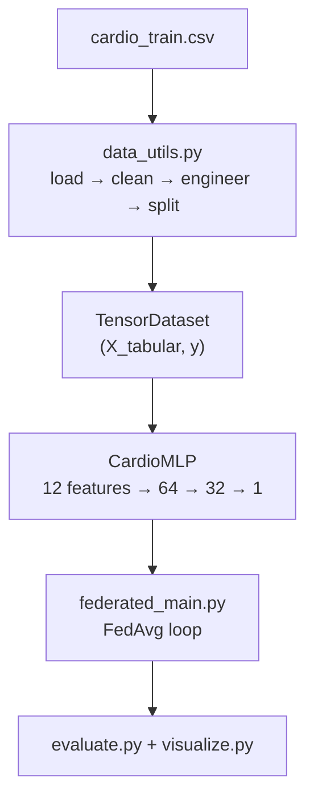
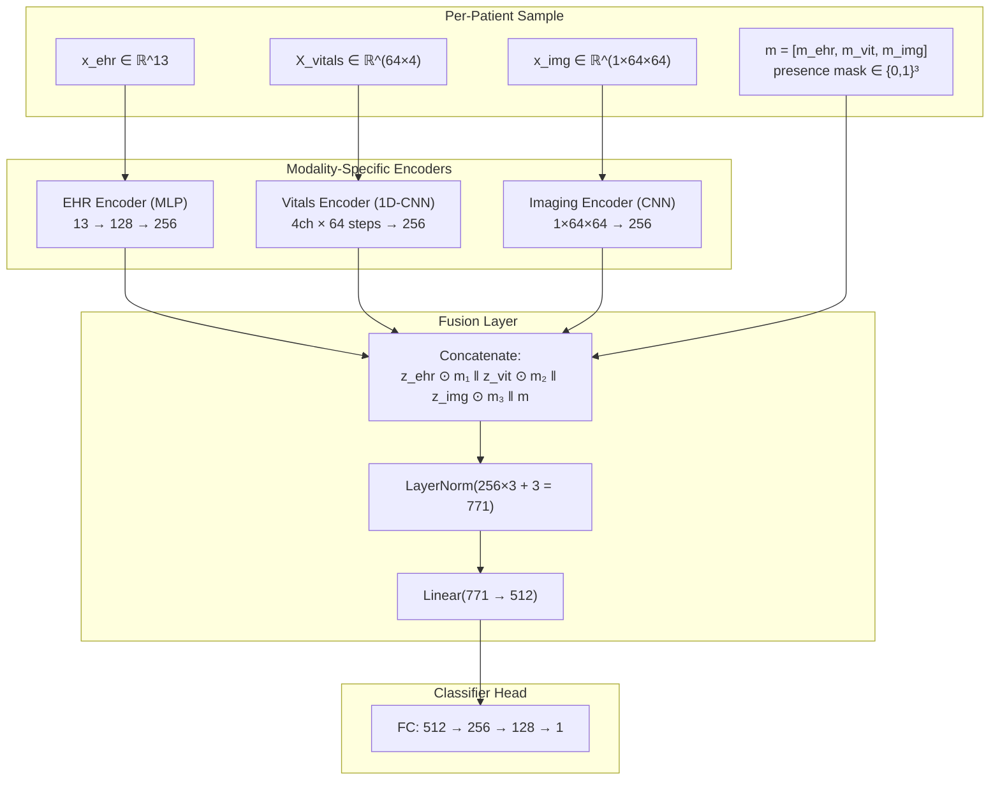
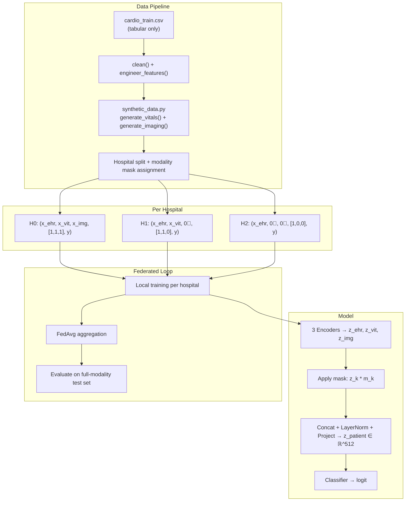

# Multimodal Data Integration & Missing-Modality Handling — Implementation Plan

## Goal

Extend the current tabular-only (EHR) federated learning pipeline to support **three data modalities** — tabular EHR, time-series vitals, and medical imaging — using modality-specific encoders fused into a shared 512-dimensional patient representation, with a **presence-mask mechanism** that gracefully handles hospitals that lack one or more modalities.

This directly implements **§4.2 (Multimodal Encoding and Fusion)** from [Methodology_Project.md](file:///home/d0ksh/Documents/Fedrated-Learning/Methodology_Project.md).

---

## Current Codebase Architecture



**Key facts about the current system:**
- **Single modality**: Only tabular EHR (13 features → 12 after dropping `hypertension_flag`)
- **Model**: Simple MLP ([`CardioMLP`](file:///home/d0ksh/Documents/Fedrated-Learning/src/model.py#L26-L57)) — `Linear→LayerNorm→ReLU→Dropout` × 2 → logit
- **Data flow**: [`prepare_data()`](file:///home/d0ksh/Documents/Fedrated-Learning/src/data_utils.py#L212-L279) returns `List[TensorDataset]` where each sample is `(X_flat, y)`
- **Training**: [`train_local()`](file:///home/d0ksh/Documents/Fedrated-Learning/federated_main.py#L76-L115) feeds flat tensors → `CardioMLP` → `BCEWithLogitsLoss`
- **Evaluation**: [`evaluate_model()`](file:///home/d0ksh/Documents/Fedrated-Learning/src/evaluate.py#L22-L75) expects `model(X_batch)` → logits

---

## User Review Required

> [!IMPORTANT]
> **Simulated Data**: Since the current dataset (`cardio_train.csv`) only has tabular columns, the time-series vitals and medical imaging data **will be synthetically generated** from existing columns. This is the standard approach for prototype-stage multimodal systems where real clinical imaging/vitals data is unavailable.
>
> - **Vitals**: Synthesized as 64-timestep × 4-channel sequences derived from `ap_hi`, `ap_lo`, `height`, `weight` with added Gaussian noise to simulate realistic temporal variation
> - **Imaging**: Synthesized as 64×64 grayscale images using a deterministic pattern seeded by patient features (simulating a simplified medical scan)

> [!WARNING]
> **Model architecture change**: The old `CardioMLP` is replaced by a new `MultimodalFusionModel`. Existing checkpoint files (`runs/checkpoints/round_*.pt`, `runs/baseline/baseline_model.pt`) will **not** be compatible with the new model. They are preserved but will need to be retrained.

> [!IMPORTANT]
> **Backward compatibility**: The codebase will be restructured to support both the old single-modality pipeline and the new multimodal pipeline. A config flag `MULTIMODAL = True` will control which path is used. Setting it to `False` restores the original behaviour.

---

## Open Questions

> [!IMPORTANT]
> 1. **Modality availability per hospital**: The plan assigns modalities non-uniformly:
>    - Hospital 0 (Older): all 3 modalities (tabular + vitals + imaging)
>    - Hospital 1 (Hypertensive): 2 modalities (tabular + vitals, no imaging)
>    - Hospital 2 (Balanced): 1 modality (tabular only)
>    
>    This realistically simulates resource disparity. Should I adjust this distribution?
>
> 2. **Embedding dimension**: The methodology specifies 256-d per encoder → 512-d fused. Should I keep these sizes, or use smaller dimensions (e.g. 128-d per encoder → 256-d fused) for faster prototyping?

---

## Proposed Architecture



**Missing-modality handling**: When modality `k` is unavailable:
- `z_k` = zero vector ∈ ℝ^256 (zero-fill)
- `m_k` = 0 (presence mask bit set to 0)
- The mask is **concatenated** into the fusion input, so the downstream layers know the zeros are intentional absence, not a meaningful signal

---

## Proposed Changes

### Component 1: Configuration

#### [MODIFY] [config.py](file:///home/d0ksh/Documents/Fedrated-Learning/src/config.py)

Add multimodal-specific configuration:

```diff
 # -- Model Architecture --------------------------------------------------------
 HIDDEN_DIMS = [64, 32]   # neurons in each hidden layer
 DROPOUT     = 0.30       # dropout probability
+
+# -- Multimodal Settings -------------------------------------------------------
+MULTIMODAL       = True       # True -> use multimodal fusion; False -> legacy MLP
+EMBED_DIM        = 256        # per-encoder embedding dimension
+FUSED_DIM        = 512        # fused patient representation dimension
+VITALS_SEQ_LEN   = 64         # time steps in vitals sequences
+VITALS_CHANNELS  = 4          # number of vital sign channels (HR, SpO2, SBP, DBP)
+IMG_SIZE         = 64         # imaging spatial resolution (IMG_SIZE × IMG_SIZE)
+IMG_CHANNELS     = 1          # grayscale
+
+# Per-hospital modality availability (indices → hospital IDs)
+# Each entry: (has_ehr, has_vitals, has_imaging)
+HOSPITAL_MODALITIES = {
+    0: (True, True, True),     # H0: all modalities
+    1: (True, True, False),    # H1: tabular + vitals (no imaging)
+    2: (True, False, False),   # H2: tabular only
+}
```

---

### Component 2: Synthetic Data Generators

#### [NEW] [synthetic_data.py](file:///home/d0ksh/Documents/Fedrated-Learning/src/synthetic_data.py)

Generates simulated vitals and imaging data from the tabular features. This module is used **only for prototyping** — in production, real data pipelines would replace it.

```python
"""
src/synthetic_data.py -- Synthetic multimodal data generators.

Generates simulated time-series vitals and medical imaging from existing
tabular features. Used for prototyping the multimodal pipeline when only
tabular EHR data is available.
"""
import numpy as np
import src.config as config


def generate_vitals(X_tabular: np.ndarray, seed: int = 42) -> np.ndarray:
    """
    Generate synthetic vitals time-series from tabular features.
    
    Uses ap_hi (col 3), ap_lo (col 4) to seed blood-pressure channels,
    and derives heart-rate / SpO2 from BMI (col 5) and age (col 0).
    
    Returns: (N, T, C) array — N patients, T=64 timesteps, C=4 channels
    """
    rng = np.random.default_rng(seed)
    N = X_tabular.shape[0]
    T = config.VITALS_SEQ_LEN
    C = config.VITALS_CHANNELS
    
    vitals = np.zeros((N, T, C), dtype=np.float32)
    
    for i in range(N):
        # Channel 0: Simulated heart rate (based on age + noise)
        base_hr = 70.0 + X_tabular[i, 0] * 5.0  # age influence
        vitals[i, :, 0] = base_hr + rng.normal(0, 3.0, T)
        
        # Channel 1: Simulated SpO2 (based on BMI + noise)
        base_spo2 = 97.0 - abs(X_tabular[i, 5]) * 0.5
        vitals[i, :, 1] = base_spo2 + rng.normal(0, 0.5, T)
        
        # Channel 2: Systolic BP (based on ap_hi + trend + noise)
        base_sbp = 120.0 + X_tabular[i, 3] * 10.0
        trend = np.linspace(0, rng.uniform(-5, 5), T)
        vitals[i, :, 2] = base_sbp + trend + rng.normal(0, 4.0, T)
        
        # Channel 3: Diastolic BP (based on ap_lo + trend + noise)
        base_dbp = 80.0 + X_tabular[i, 4] * 5.0
        vitals[i, :, 3] = base_dbp + trend * 0.6 + rng.normal(0, 3.0, T)
    
    # Z-score normalise per channel across all patients
    for c in range(C):
        mu = vitals[:, :, c].mean()
        sigma = vitals[:, :, c].std() + 1e-8
        vitals[:, :, c] = (vitals[:, :, c] - mu) / sigma
    
    return vitals


def generate_imaging(X_tabular: np.ndarray, seed: int = 42) -> np.ndarray:
    """
    Generate synthetic medical images from tabular features.
    
    Creates deterministic grayscale patterns seeded by patient features,
    simulating simplified chest X-ray-like structures.
    
    Returns: (N, 1, H, W) array — N patients, 1 channel, 64×64 pixels
    """
    rng = np.random.default_rng(seed)
    N = X_tabular.shape[0]
    H = W = config.IMG_SIZE
    
    images = np.zeros((N, config.IMG_CHANNELS, H, W), dtype=np.float32)
    
    for i in range(N):
        # Create a base pattern influenced by patient features
        feat_hash = X_tabular[i, :6].sum()  # deterministic seed per patient
        patient_rng = np.random.default_rng(int(abs(feat_hash * 1000)) % (2**31))
        
        # Simulate tissue density pattern
        base = patient_rng.uniform(0.2, 0.8, (H, W)).astype(np.float32)
        
        # Add circular structure (simulating cardiac region)
        yy, xx = np.ogrid[:H, :W]
        cx, cy = H // 2 + int(X_tabular[i, 0] * 2), W // 2
        r = 12 + int(abs(X_tabular[i, 5]) * 3)
        mask = ((yy - cy)**2 + (xx - cx)**2) < r**2
        base[mask] += 0.3
        
        # Normalise to [0, 1]
        base = (base - base.min()) / (base.max() - base.min() + 1e-8)
        images[i, 0] = base
    
    return images
```

---

### Component 3: Multimodal Encoders & Fusion Model

#### [NEW] [multimodal_model.py](file:///home/d0ksh/Documents/Fedrated-Learning/src/multimodal_model.py)

The core new module — implements the three encoders and the fusion layer per §4.2 of the methodology.

```python
"""
src/multimodal_model.py -- Multimodal encoders and fusion model.

Implements:
  - EHREncoder:    MLP that maps tabular features → ℝ^256
  - VitalsEncoder: 1D-CNN that maps (T, C) time-series → ℝ^256
  - ImagingEncoder: 2D-CNN that maps (1, H, W) images → ℝ^256
  - MultimodalFusionModel: Fuses encoder outputs with presence mask → classifier
"""
import torch
import torch.nn as nn
import src.config as config


class EHREncoder(nn.Module):
    """MLP encoder for tabular EHR features → 256-d embedding."""
    def __init__(self, n_features: int, embed_dim: int = config.EMBED_DIM,
                 dropout: float = config.DROPOUT):
        super().__init__()
        self.net = nn.Sequential(
            nn.Linear(n_features, 128),
            nn.LayerNorm(128),
            nn.ReLU(),
            nn.Dropout(dropout),
            nn.Linear(128, embed_dim),
            nn.LayerNorm(embed_dim),
            nn.ReLU(),
        )

    def forward(self, x):
        return self.net(x)


class VitalsEncoder(nn.Module):
    """1D-CNN encoder for time-series vitals → 256-d embedding."""
    def __init__(self, in_channels: int = config.VITALS_CHANNELS,
                 embed_dim: int = config.EMBED_DIM):
        super().__init__()
        self.conv = nn.Sequential(
            # Block 1
            nn.Conv1d(in_channels, 32, kernel_size=5, padding=2),
            nn.BatchNorm1d(32),
            nn.ReLU(),
            nn.MaxPool1d(2),
            # Block 2
            nn.Conv1d(32, 64, kernel_size=3, padding=1),
            nn.BatchNorm1d(64),
            nn.ReLU(),
            nn.MaxPool1d(2),
            # Block 3
            nn.Conv1d(64, 128, kernel_size=3, padding=1),
            nn.BatchNorm1d(128),
            nn.ReLU(),
            nn.AdaptiveAvgPool1d(1),  # global average pooling → (B, 128, 1)
        )
        self.fc = nn.Sequential(
            nn.Linear(128, embed_dim),
            nn.LayerNorm(embed_dim),
            nn.ReLU(),
        )

    def forward(self, x):
        # x: (B, T, C) → transpose to (B, C, T) for Conv1d
        x = x.transpose(1, 2)
        x = self.conv(x)
        x = x.squeeze(-1)  # (B, 128)
        return self.fc(x)


class ImagingEncoder(nn.Module):
    """Lightweight 2D-CNN encoder for medical images → 256-d embedding."""
    def __init__(self, in_channels: int = config.IMG_CHANNELS,
                 embed_dim: int = config.EMBED_DIM):
        super().__init__()
        self.conv = nn.Sequential(
            # Block 1: 64x64 → 32x32
            nn.Conv2d(in_channels, 16, kernel_size=3, padding=1),
            nn.BatchNorm2d(16),
            nn.ReLU(),
            nn.MaxPool2d(2),
            # Block 2: 32x32 → 16x16
            nn.Conv2d(16, 32, kernel_size=3, padding=1),
            nn.BatchNorm2d(32),
            nn.ReLU(),
            nn.MaxPool2d(2),
            # Block 3: 16x16 → 8x8
            nn.Conv2d(32, 64, kernel_size=3, padding=1),
            nn.BatchNorm2d(64),
            nn.ReLU(),
            nn.MaxPool2d(2),
            # Block 4: 8x8 → 1x1 (global avg pool)
            nn.AdaptiveAvgPool2d(1),
        )
        self.fc = nn.Sequential(
            nn.Linear(64, embed_dim),
            nn.LayerNorm(embed_dim),
            nn.ReLU(),
        )

    def forward(self, x):
        # x: (B, C, H, W)
        x = self.conv(x)
        x = x.view(x.size(0), -1)  # (B, 64)
        return self.fc(x)


class MultimodalFusionModel(nn.Module):
    """
    Multimodal fusion model with missing-modality handling.
    
    Architecture (per §4.2 of Methodology):
      1. Three encoders produce z_ehr, z_vitals, z_img ∈ ℝ^256
      2. Missing modalities: z_k = 0, m_k = 0
      3. Concatenate: [z_ehr * m_ehr || z_vit * m_vit || z_img * m_img || m]
      4. LayerNorm → Linear projection → 512-d fused representation
      5. Classifier head → 1 logit
    """
    def __init__(self, n_ehr_features: int,
                 embed_dim: int = config.EMBED_DIM,
                 fused_dim: int = config.FUSED_DIM,
                 dropout: float = config.DROPOUT):
        super().__init__()
        
        self.embed_dim = embed_dim
        self.n_modalities = 3
        
        # Modality-specific encoders
        self.ehr_encoder = EHREncoder(n_ehr_features, embed_dim, dropout)
        self.vitals_encoder = VitalsEncoder(config.VITALS_CHANNELS, embed_dim)
        self.imaging_encoder = ImagingEncoder(config.IMG_CHANNELS, embed_dim)
        
        # Fusion layer: 3 * embed_dim + 3 (mask bits)
        fusion_input_dim = self.n_modalities * embed_dim + self.n_modalities
        self.fusion = nn.Sequential(
            nn.LayerNorm(fusion_input_dim),
            nn.Linear(fusion_input_dim, fused_dim),
            nn.ReLU(),
            nn.Dropout(dropout),
        )
        
        # Classifier head
        self.classifier = nn.Sequential(
            nn.Linear(fused_dim, 256),
            nn.LayerNorm(256),
            nn.ReLU(),
            nn.Dropout(dropout),
            nn.Linear(256, 128),
            nn.LayerNorm(128),
            nn.ReLU(),
            nn.Dropout(dropout),
            nn.Linear(128, 1),
        )
    
    def forward(self, x_ehr, x_vitals, x_img, modality_mask):
        """
        Parameters
        ----------
        x_ehr   : (B, n_ehr_features)  — tabular features
        x_vitals: (B, T, C)            — time-series vitals
        x_img   : (B, 1, H, W)         — medical image
        modality_mask: (B, 3)           — [m_ehr, m_vitals, m_img] ∈ {0, 1}
        
        Returns
        -------
        logits  : (B,) — raw logits for binary classification
        """
        B = x_ehr.size(0)
        
        # Encode each modality
        z_ehr = self.ehr_encoder(x_ehr)          # (B, 256)
        z_vit = self.vitals_encoder(x_vitals)    # (B, 256)
        z_img = self.imaging_encoder(x_img)      # (B, 256)
        
        # Apply presence mask: zero out embeddings for missing modalities
        m_ehr = modality_mask[:, 0:1]   # (B, 1)
        m_vit = modality_mask[:, 1:2]   # (B, 1)
        m_img = modality_mask[:, 2:3]   # (B, 1)
        
        z_ehr = z_ehr * m_ehr    # zero-fill if m_ehr = 0
        z_vit = z_vit * m_vit
        z_img = z_img * m_img
        
        # Concatenate embeddings + mask
        fused_input = torch.cat([z_ehr, z_vit, z_img, modality_mask], dim=1)
        
        # Fusion projection
        z_patient = self.fusion(fused_input)  # (B, 512)
        
        # Classify
        logits = self.classifier(z_patient)
        return logits.squeeze(-1)  # (B,)
```

---

### Component 4: Multimodal Data Pipeline

#### [MODIFY] [data_utils.py](file:///home/d0ksh/Documents/Fedrated-Learning/src/data_utils.py)

Add a new `prepare_multimodal_data()` function alongside the existing `prepare_data()`, keeping backward compatibility. The key change: each sample in the dataset becomes a **5-tuple** `(x_ehr, x_vitals, x_img, mask, y)` instead of the current `(X, y)`.

```python
# New function added after prepare_data()

def prepare_multimodal_data() -> Tuple[
    List[TensorDataset],   # hospital multimodal datasets
    TensorDataset,          # test multimodal dataset  
    StandardScaler,         # fitted scaler
    int,                    # n_ehr_features
]:
    """
    Full multimodal pipeline: load → clean → engineer → split →
    generate synthetic vitals & imaging → apply per-hospital modality masks →
    return TensorDatasets with (x_ehr, x_vitals, x_img, mask, y) tuples.
    """
    # Reuse existing tabular pipeline
    # ... (calls load_raw, clean, engineer_features, train_test_split, scale)
    # Then generate synthetic vitals and imaging
    # Then apply hospital-specific modality masks
    # Returns datasets where missing modalities are zero-filled
```

The test dataset gets **all modalities** (full mask = [1, 1, 1]) to evaluate the model under ideal conditions.

---

### Component 5: Updated Model Utilities

#### [MODIFY] [model.py](file:///home/d0ksh/Documents/Fedrated-Learning/src/model.py)

Keep existing `CardioMLP` untouched. Add multimodal imports and factory function:

```diff
+from src.multimodal_model import MultimodalFusionModel
+
+def build_model(n_features: int, multimodal: bool = config.MULTIMODAL):
+    """Factory: returns the appropriate model based on config."""
+    if multimodal:
+        return MultimodalFusionModel(n_ehr_features=n_features)
+    else:
+        return CardioMLP(n_features=n_features)
```

---

### Component 6: Updated Federated Training Loop

#### [MODIFY] [federated_main.py](file:///home/d0ksh/Documents/Fedrated-Learning/federated_main.py)

The main changes to `train_local()` and `main()`:

```diff
 def train_local(model, dataset, device, ...):
     loader = DataLoader(dataset, batch_size=batch_size, shuffle=True, drop_last=True)
     ...
     for _ in range(local_epochs):
         for batch in loader:
-            X_batch, y_batch = batch
-            logits = model(X_batch)
+            if config.MULTIMODAL:
+                x_ehr, x_vit, x_img, mask, y_batch = [b.to(device) for b in batch]
+                logits = model(x_ehr, x_vit, x_img, mask)
+            else:
+                X_batch, y_batch = batch[0].to(device), batch[1].to(device)
+                logits = model(X_batch)
             loss = criterion(logits, y_batch)
             ...
```

```diff
 def main():
     ...
-    hospital_datasets, test_dataset, scaler, n_features = prepare_data()
-    global_model = CardioMLP(n_features=n_features).to(device)
+    if config.MULTIMODAL:
+        hospital_datasets, test_dataset, scaler, n_features = prepare_multimodal_data()
+        global_model = MultimodalFusionModel(n_ehr_features=n_features).to(device)
+    else:
+        hospital_datasets, test_dataset, scaler, n_features = prepare_data()
+        global_model = CardioMLP(n_features=n_features).to(device)
```

---

### Component 7: Updated Evaluation

#### [MODIFY] [evaluate.py](file:///home/d0ksh/Documents/Fedrated-Learning/src/evaluate.py)

`evaluate_model()` needs to handle the 5-tuple multimodal dataset:

```diff
 def evaluate_model(model, dataset, batch_size=512, device="cpu"):
     ...
     with torch.no_grad():
         for batch in loader:
-            X_batch = batch[0].to(device)
-            y_batch = batch[1].to(device)
-            logits = model(X_batch)
+            if len(batch) == 5:  # multimodal: (ehr, vit, img, mask, y)
+                x_ehr, x_vit, x_img, mask, y_batch = [b.to(device) for b in batch]
+                logits = model(x_ehr, x_vit, x_img, mask)
+            else:  # legacy: (X, y)
+                X_batch, y_batch = batch[0].to(device), batch[1].to(device)
+                logits = model(X_batch)
             loss = criterion(logits, y_batch)
```

---

### Component 8: Updated Baseline

#### [MODIFY] [baseline.py](file:///home/d0ksh/Documents/Fedrated-Learning/baseline.py)

Similar changes to `train_centralized()` to handle the 5-tuple batch format when `MULTIMODAL=True`.

---

## Complete File Manifest

| File | Action | Description |
|------|--------|-------------|
| [`src/config.py`](file:///home/d0ksh/Documents/Fedrated-Learning/src/config.py) | MODIFY | Add multimodal flags, dimensions, hospital modality map |
| [`src/synthetic_data.py`](file:///home/d0ksh/Documents/Fedrated-Learning/src/synthetic_data.py) | NEW | Vitals & imaging generators from tabular features |
| [`src/multimodal_model.py`](file:///home/d0ksh/Documents/Fedrated-Learning/src/multimodal_model.py) | NEW | `EHREncoder`, `VitalsEncoder`, `ImagingEncoder`, `MultimodalFusionModel` |
| [`src/data_utils.py`](file:///home/d0ksh/Documents/Fedrated-Learning/src/data_utils.py) | MODIFY | Add `prepare_multimodal_data()` with per-hospital modality masking |
| [`src/model.py`](file:///home/d0ksh/Documents/Fedrated-Learning/src/model.py) | MODIFY | Add `build_model()` factory, keep `CardioMLP` intact |
| [`src/evaluate.py`](file:///home/d0ksh/Documents/Fedrated-Learning/src/evaluate.py) | MODIFY | Handle 5-tuple multimodal batches |
| [`federated_main.py`](file:///home/d0ksh/Documents/Fedrated-Learning/federated_main.py) | MODIFY | Multimodal data loading + training loop |
| [`baseline.py`](file:///home/d0ksh/Documents/Fedrated-Learning/baseline.py) | MODIFY | Multimodal data loading + centralized training |
| [`src/client.py`](file:///home/d0ksh/Documents/Fedrated-Learning/src/client.py) | MODIFY | Handle multimodal batches in Flower client |
| [`requirements.txt`](file:///home/d0ksh/Documents/Fedrated-Learning/requirements.txt) | MODIFY | Add `torchvision>=0.15.0` |

---

## Data Flow After Changes



---

## Missing-Modality Mechanism — Detailed Design

The fusion handles missing modalities **without any architecture changes at inference time**:

| Hospital | Available Data | Mask `m` | What happens |
|----------|---------------|----------|--------------|
| H0 (all) | EHR + Vitals + Imaging | `[1, 1, 1]` | All 3 encoders produce real embeddings |
| H1 (no imaging) | EHR + Vitals | `[1, 1, 0]` | `z_img = encoder(zeros)` but then `z_img *= 0` → zero-fill. Mask tells classifier "imaging is absent" |
| H2 (EHR only) | EHR only | `[1, 0, 0]` | Both `z_vit` and `z_img` are zeroed. Classifier sees `m=[1,0,0]` and adapts its internal weighting |

**Why this works in federated setting**: All hospitals share the **same model architecture** (all 3 encoders + fusion + classifier). Hospitals with fewer modalities still train all parameters, but the gradient signal through missing-modality encoder weights is zero (because `z_k * 0 = 0` kills the gradient). This means:
- The **EHR encoder** gets gradient updates from all 3 hospitals
- The **vitals encoder** gets updates from H0 + H1 (2 hospitals)
- The **imaging encoder** gets updates from H0 only

FedAvg then naturally aggregates these heterogeneous updates — encoders used by more hospitals get more robust weight-averaged parameters.

---

## Verification Plan

### Automated Tests

```bash
# 1. Verify models instantiate and produce correct output shapes
python -c "
from src.multimodal_model import *
import torch
m = MultimodalFusionModel(n_ehr_features=13)
x_ehr = torch.randn(4, 13)
x_vit = torch.randn(4, 64, 4)
x_img = torch.randn(4, 1, 64, 64)
mask = torch.tensor([[1,1,1],[1,1,0],[1,0,0],[1,1,1]], dtype=torch.float32)
out = m(x_ehr, x_vit, x_img, mask)
assert out.shape == (4,), f'Expected (4,), got {out.shape}'
print('✓ MultimodalFusionModel forward pass OK')
"

# 2. Verify synthetic data generators produce correct shapes
python -c "
from src.synthetic_data import *
import numpy as np
X = np.random.randn(100, 13).astype(np.float32)
vit = generate_vitals(X)
assert vit.shape == (100, 64, 4), f'Expected (100,64,4), got {vit.shape}'
img = generate_imaging(X)
assert img.shape == (100, 1, 64, 64), f'Expected (100,1,64,64), got {img.shape}'
print('✓ Synthetic data generators OK')
"

# 3. Verify prepare_multimodal_data() returns correct dataset format
python -c "
from src.data_utils import prepare_multimodal_data
datasets, test_ds, scaler, n = prepare_multimodal_data()
sample = datasets[0][0]
assert len(sample) == 5, f'Expected 5-tuple, got {len(sample)}'
print(f'✓ Multimodal dataset: {len(sample)}-tuple samples, n_features={n}')
"

# 4. Run the full federated pipeline
python federated_main.py

# 5. Run the baseline
python baseline.py

# 6. Verify backward compatibility (MULTIMODAL=False should still work)
# Temporarily set MULTIMODAL=False in config.py and run federated_main.py
```

### Manual Verification

1. **Check console output**: Verify each hospital logs its modality availability during training
2. **Check metrics**: Federated accuracy should be > 65% (lower than tabular-only is OK since synthetic data adds noise)
3. **Compare**: Run with `MULTIMODAL=False` and verify identical results to the current baseline (backward compatibility)
4. **Check missing-modality**: Hospital 2 (EHR-only) should still contribute meaningfully to the federated model despite having only one modality
